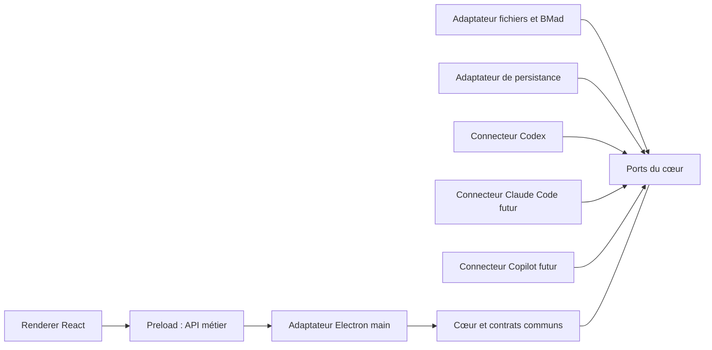

# Architecture Spine — Madness

## Design Paradigm

Monolithe modulaire local avec ports et adaptateurs. Le cœur possède les cas d'usage et les contrats ; Electron, les fichiers, le stockage et les fournisseurs sont des adaptateurs. Une interface commune, un cœur local, un connecteur par fournisseur. Codex est livré d'abord ; Claude Code et GitHub Copilot sont des cibles suivantes.

## Invariants & Rules

### AD-1 — Frontières du cœur et d'Electron [ADOPTED]

- **Binds:** R1, R12–R17, R19–R23 ; toutes les unités.
- **Prevents:** dépendance du domaine à un fournisseur et accès privilégiés dispersés dans l'interface.
- **Rule:** le cœur ne dépend ni d'Electron, ni d'un SDK fournisseur, ni du moteur de stockage. Les adaptateurs implémentent ses ports. Le renderer n'accède ni à Node, ni aux fichiers, ni aux processus : `contextIsolation: true`, `nodeIntegration: false`, `sandbox: true`. Le preload expose uniquement les opérations métier et abonnements des contrats communs, sans API Electron/IPC générique. Main valide appelant, paramètres et portée avant délégation. Le coordinateur d'exécution du cœur est l'autorité du cycle de vie ; Main lui signale fermeture et redémarrage, les connecteurs possèdent les processus qu'ils gèrent et lui rapportent arrêt, interruption ou résultat inconnu. Le contrat de ce cycle est établi en G0 avant ses consommateurs. Les aperçus de fichiers n'exécutent pas leurs scripts.



Les flèches indiquent les dépendances de code. Aucun adaptateur n'importe un autre connecteur ; le cœur coordonne leurs retours par ses ports.

### AD-2 — Contexte et contrats communs [ADOPTED]

- **Binds:** R1, R2, R5, R11–R19, R22.
- **Prevents:** réponse envoyée au mauvais projet, fournisseur changé implicitement et messages incompatibles entre lots.
- **Rule:** une conversation capture projet, initiative éventuelle, fournisseur et connexion à sa création ; la navigation ne change pas ces rattachements. Changer de fournisseur ouvre une autre conversation. Commandes et événements transportent leurs identités de contexte et leur corrélation ; les identifiants natifs restent des références du connecteur. Une action exigeant une initiative vérifie le contexte BMad résolu avant lancement ; tout désaccord est résolu explicitement. Les outils sans initiative acceptent ce contexte absent. Le cœur possède l'unique module de contrats versionnés, partagé par UI et adaptateurs, validé à l'exécution aux frontières et établi en G0 avant les lots consommateurs.

### AD-3 — Autorités distinctes et workflows natifs

- **Binds:** R3, R5–R13, R18–R19.
- **Prevents:** second moteur BMad, catalogue figé et fichier assimilé à une session ou une validation.
- **Rule:** fichiers du projet = preuves BMad ; fournisseur = activité observée ; décision humaine explicite rattachée à son objet et à la révision affichée = acceptation. Pour un fichier, cette révision est identifiée par l'empreinte SHA-256 de ses octets lue avec l'aperçu. Un contenu modifié conserve l'accord historique sur l'ancienne révision, sans le transférer au contenu courant dont l'acceptation est inconnue. Fait, déduction et proposition gardent source, portée et fraîcheur. Catalogue et aides proviennent de l'installation réellement utilisée, selon ses modules et priorités de racines ; les métadonnées ne sont pas invocables. « Aide chargée » reste distinct de « recommandation de l'agent ». Les workflows installés conduisent le travail selon leurs conditions ; Madness présente, invoque, relaie et observe. Aucun enchaînement, pourcentage global ou ordre obligatoire n'est déduit du catalogue. Une modification externe invalide les projections concernées puis entraîne leur relecture, sans effacer la saisie ni attribuer auteur, session ou accord inconnus.

### AD-4 — Cycle des échanges et validité des attentes

- **Binds:** R2, R8, R13–R18, R22.
- **Prevents:** faux état « envoyé », réponse à une demande expirée et confusion entre fin de tour, fin de workflow et validation.
- **Rule:** situation du projet, activité, attentes et acceptation sont des états distincts. Les événements sont corrélés à la conversation, au tour et à la demande d'origine ; leur projection est commune à l'accueil et au projet. Une demande n'est répondable que si le moteur la reconnaît encore active. Résolution, interruption ou clôture invalident le contrôle ; une réponse tardive conserve la saisie et explique l'expiration, sans être redirigée. Envoi vide ou concurrent de la même opération refusé ; « envoyé » exige un accusé fiable du connecteur. Résultat inconnu après coupure : réconcilier avant tout réessai avec effet. Navigation et délai ne valent pas accord. Le récapitulatif distingue résultat proposé, décisions humaines connues, fichiers et action suivante ; une synthèse manquante n'est pas remplacée par des décisions inventées.

### AD-5 — Persistance locale sans relance [ADOPTED]

- **Binds:** R1, R2, R7, R16–R17, R20, R22 ; Q5.
- **Prevents:** perte de brouillons, propriétaires concurrents de l'historique et relance après redémarrage ou remplacement du programme.
- **Rule:** le service de persistance du cœur conserve projets, conversations et rattachements, échanges reçus, brouillons, préférences et dernier état connu hors du dossier installé et des artefacts BMad. Les autres modules utilisent son port, sans écriture directe du stockage. Écritures liées cohérentes, schéma versionné et migrations préservant les données. Une sauvegarde échouée n'est pas annoncée comme durable ; une préférence indisponible reste utilisable en mémoire. Restaurer le contexte ne lance ni moteur ni tour ; activité et attentes restent historiques jusqu'à vérification. Les secrets fournisseurs ne sont pas enregistrés dans les échanges. Cette base ne reconstitue pas les conversations externes et ne devient pas l'autorité sur les preuves BMad.

### AD-6 — Effets et consentement vérifiables

- **Binds:** R3–R4, R14, R17, R19.
- **Prevents:** accord réutilisé pour un autre effet, réinstallation implicite et succès annoncé sans résultat vérifié.
- **Rule:** lorsqu'un accord est requis, l'opération porte identifiant, portée, effets et préconditions. L'initialisation prépare les changements exacts avant toute écriture dans le projet ; l'accord est lié au plan et devient caduc si ses préconditions changent. Annuler laisse le dossier intact. L'adaptateur utilise l'outillage BMad qualifié et vérifie l'installation après application. L'approbation d'une opération ne valide pas un livrable. Réussite, échec et résultat inconnu sont distincts. Ouvrir dans l'éditeur rapporte seulement le retour observable : acceptation par l'OS ne prouve pas la lecture effective dans l'éditeur. En cas d'échec, chemin copiable, sélection et saisie restent disponibles.

### AD-7 — Connecteurs et profils qualifiés

- **Binds:** R3, R10–R17, R22–R24, C4.
- **Prevents:** équivalence supposée des abonnements et disponibilité annoncée sur le seul numéro de version.
- **Rule:** le connecteur annonce identité, version, état et capacités réelles : dialogue, événements, questions, approbations, interruption et reprise. Le contrat commun conserve les différences ; une capacité absente est expliquée, sans simulation. L'invocation affichée est celle effectivement envoyée, dans le contexte capturé et selon les conditions du workflow. Avant chaque opération, le cœur vérifie ses prérequis pertinents : accès, outils, profil et connexion nécessaires. Un diagnostic invalidé ou périmé selon son profil partagé exige un contrôle ciblé frais avant l'effet, sinon l'action est bloquée avec une récupération expliquée. Les profils reconnaissent des formats et fonctions BMad/moteur testés ; version inconnue, absence et incompatibilité restent distinctes. G1–G3 conditionnent l'annonce des capacités correspondantes. Authentification et facturation restent propres au fournisseur ; l'abonnement demandé n'est pas remplacé silencieusement par une autre API payante.

### AD-8 — Contrats UX, langues et thèmes [ADOPTED]

- **Binds:** R2, R6–R24, C1, C5 ; Q6.
- **Prevents:** UX reconstruite depuis un starter, contexte perdu au repli et identifiants techniques traduits.
- **Rule:** l'UX est le premier critère d'arbitrage. DESIGN.md et EXPERIENCE.md gouvernent l'interface et ses comportements, avec la base française claire acceptée. Le novice reçoit une recommandation motivée, des alternatives utiles et l'objectif, les entrées, les conditions et les effets attendus de l'action. Textes UI : clés partagées français/anglais ; couleurs : tokens sémantiques clair/sombre. Identifiants, invocations, chemins et artefacts ne sont pas traduits ou modifiés par la langue UI, qui ne réécrit pas la langue BMad du projet. Sally complète les contrats pour ces variantes avant leur implémentation. Repli, redimensionnement et lecture des fichiers conservent projet, initiative, conversation et brouillon. Clavier, focus, zoom, annonces d'état et réduction du mouvement de R21 s'appliquent à toutes les variantes, sans certification d'accessibilité prétendue.

### AD-9 — Maintenance et livraison [ADOPTED]

- **Binds:** R3, R17, R22–R24 ; demande du porteur sur les mises à jour.
- **Prevents:** versions figées par l'architecture, données perdues en mise à niveau et fenêtre fonctionnelle assimilée à une connexion fonctionnelle.
- **Rule:** chaque livraison conserve un assemblage reproductible par lockfile et ressources ; les montées de version sont explicites, vérifiées par types, contrats, reprise et packaging avant republication. Les previews sont admises si choisies et signalées ; aucun patch local tiers ne devient une dépendance implicite. Projets et données utilisateur restent indépendants des binaires. Les outils requis sont détectés et leur absence expliquée. Réseau et certificats de chaque connecteur sont vérifiés séparément sur la machine cible ; la configuration Electron n'est pas supposée s'appliquer aux processus fournisseurs. Hors ligne, la lecture locale reste possible avec sa fraîcheur connue. Avant la première livraison, G4 vérifie l'installation sur machine Windows cible et les trois parcours réels avec une personne peu familière de BMad. Aucun service d'orchestration Madness distant n'est nécessaire. L'auto-updater n'est pas requis pour cette première livraison.

### AD-10 — Graphe du projet isolé et traçable

- **Binds:** extension Graphify demandée par le porteur, à dériver en exigences par Sofia ; R1, R7–R8, R19–R24.
- **Prevents:** graphe rattaché au mauvais projet, analyse consommant un modèle par défaut, couplage UI au format tiers et relations présentées comme une preuve BMad.
- **Rule:** Graphify est un adaptateur d'analyse du projet, distinct des fournisseurs d'agents et des workflows BMad. Le cœur possède le port d'analyse, le contrat `GraphSnapshot` et ses règles communes de validation, établis avant ses consommateurs ; l'adaptateur assure le décodage, la validation et la normalisation des artefacts tiers selon ce contrat. Une génération à la demande utilise un processus isolé par analyse, avec racine projet explicite et CWD, sorties et cache dans un espace Madness distinct par projet et par analyse, sans partage avec une autre analyse. Toute publication vérifie l'identité projet/analyse attendue. Les écritures restent dans cet espace ; sources, instructions, skills, hooks, plugins et configurations du projet ou de l'utilisateur ne sont pas modifiés. Premier profil : code et dépendances uniquement, `--code-only`, `GRAPHIFY_BACKEND=none`, `GRAPHIFY_NO_AUTO_REFRESH=1` et `GRAPHIFY_OUT=graphify-out` imposés dans le seul environnement du processus enfant, sans changer celui de l'utilisateur ; aucun enrichissement sémantique ou modèle implicite. Le coordinateur du cœur suit ce travail et sa fermeture sans le présenter comme l'activité d'un agent BMad.

L'adaptateur valide outil, type d'artefact et version de schéma, puis produit un snapshot rattaché au projet, à la racine, au périmètre et à une révision des sources incluant les changements non commités. Il conserve provenance, fichiers/lignes, relations et niveaux `EXTRACTED` / `INFERRED` / `AMBIGUOUS`. Pour le profil Graphify observé, `_src`/`_tgt` priment, sinon le sens est `source` → `target`, même si le JSON porte `directed: false`. La UI consomme le contrat commun, pas le JSON ni les scripts HTML natifs. Les ressources de visualisation sont livrées localement dans Madness.

L'interface distingue absence, analyse, graphe disponible, partiel, ancien, incompatible et échec. Un rafraîchissement ou une annulation conserve le dernier snapshot complet connu, avec sa fraîcheur explicite ; un changement pendant l'analyse ne produit pas un résultat présenté comme actuel. La sélection d'un nœud rejoint le panneau de fichiers dans le projet du snapshot, après vérification de la référence. Recherche et liste de relations accessibles complètent le graphe ; les règles UX d'AD-8 s'appliquent. Le module indisponible ne bloque pas les parcours BMad. Aucune validation, étape accomplie ou complétude de la solution n'est déduite du graphe. Le porteur inclut cette vue dans la V1, après la base Windows/Codex ; G5 conditionne sa disponibilité et la clôture de ce périmètre V1.

## Consistency Conventions

| Concern | Convention |
|---|---|
| Propriétaires | Cœur : projets, conversations, opérations, attentes, snapshots de graphe et coordination du cycle de vie ; BMad : preuves/configuration/catalogue ; connecteur : identifiants natifs, transport et processus gérés ; Graphify : extraction et normalisation derrière le port d'analyse ; persistance : stockage ; Main : événements OS et composition ; renderer : présentation et saisie. |
| Contrats | Un module possédé par le cœur : commandes, événements, projections, erreurs et capacités. IDs opaques, version explicite et ordre d'ingestion local ; l'horloge seule ne détermine pas l'ordre. Aucun payload natif consommé directement par la UI. |
| Erreurs | Code stable, message localisable, contexte, corrélation, résultat connu/inconnu et récupération ; secrets exclus. Détails utiles accessibles sans remplacer l'explication. |
| Affichage | Identité connue ou explicitement inconnue ; source et fraîcheur visibles ; attentes durables à l'accueil et au projet. Les fragments de streaming ne créent pas chacun une alerte de lecteur d'écran. |
| Écritures | Contexte capturé, garde d'envoi côté cœur, confirmation côté connecteur. Aucun rejeu automatique d'un effet au résultat inconnu. |
| Configuration | Les préférences Madness ne réécrivent pas le projet. Une configuration BMad change par une opération explicite de son adaptateur, selon les conditions du workflow. |

## Stack

Versions relevées le 23 octobre 2026, à qualifier ensemble en G0. Ce n'est pas un assemblage déjà installé ou testé. Le premier lockfile qualifié puis le code possèdent les versions ; ce tableau ne bloque pas leurs mises à jour.

| Name | Version |
|---|---|
| Electron | 45.0.0 |
| electron-vite | 6.0.0 |
| electron-builder | 26.15.3 |
| TypeScript | 7.0.2 |
| React / react-dom | 19.3.1 |
| Vite | 8.3.5 |
| @quick-start/create-electron | 1.0.31 |
| Graphify (paquet graphifyy, version déclarée dans le dépôt) | 0.9.94 |

Le starter React + TypeScript retenu n'impose pas ses defaults : les sources inspectées conservent Electron `^44.7.2`, TypeScript `^5.9.3`, `sandbox: false` et un pont Electron générique. G0 les adapte à AD-1, vérifie TypeScript 7 avec l'outillage puis produit le paquet Windows. [Registre](.working/versions-registre.json) et [starter inspecté](.working/starter-verifie.json) sont des preuves de recherche, sans preuve de build.

La branche Graphify `v8` n'est pas sa version de paquet. Python ≥ 3.10 est requis ; le choix du runtime, du paquet effectivement distribué et du profil de schéma relève de G5, avec les [sources et SHA relevés](.working/graphify-sources.json). Aucun Graphify n'a été installé ou exécuté ici.

## Structural Seed

```text
src/
  core/                 cas d'usage, état et ports
  contracts/            contrat commun possédé par le cœur
  main/                 composition Electron et cycle de vie
  preload/              pont étroit
  renderer/             composants, traductions et tokens UX
  adapters/
    bmad/               diagnostic, preuves, catalogue, initialisation
    persistence/        conversations, brouillons et préférences
    analysis/graphify/  analyse locale et normalisation du graphe
    providers/codex/    premier connecteur réel
resources/              ressources distribuées nécessaires
```

Main compose le cœur et les adaptateurs, qui pilotent les processus locaux. Le mode développement utilise le serveur du starter ; le paquet Windows contient les ressources compilées et ne dépend pas de ce serveur. Les futurs connecteurs rejoignent le même port, sans service Madness supplémentaire à déployer.

| Connexion | Piste | Qualification avant disponibilité |
|---|---|---|
| Codex | `codex app-server` local, JSONL sur stdio ; schémas observés dans le CLI 0.144.6. | G1 : authentification éligible à Madness, versions et dialogues réels. Interface expérimentale ; seul l'export des schémas est constaté. |
| Claude Code abonnement | Binaire natif et authentification du fournisseur, voie à qualifier. | Aucun login claude.ai intégré via SDK présumé autorisé ; conditions et dialogue à établir. |
| Claude Code Bedrock | Connexion AWS documentée pour Claude Code. | Identité AWS, accès aux modèles, événements et autorisations réels. Distinct de l'abonnement Claude. |
| GitHub Copilot | SDK officiel et identité de l'utilisateur Copilot. | Runtime, abonnement, chargement BMad et parcours réels ; aucune parité supposée. |

Les [sources des connecteurs](.working/recherche-connecteurs.md) portent les détails. La licence reste ouverte : gratuit ne signifie pas open source et ne décide pas d'une voie d'authentification réservée à ces projets.

## Capability → Architecture Map

| Capability / Area | Lives in | Governed by |
|---|---|---|
| R1–R2 : projets, récents et attentes | Cœur, persistance, accueil | AD-2, AD-4, AD-5 |
| R3–R4 : diagnostic, initialisation | Adaptateur BMad, opérations du cœur | AD-3, AD-6, AD-7 ; G2–G3 |
| R5 : initiatives et contexte | Cœur, adaptateur BMad, contrats | AD-2, AD-3 |
| R6–R8 : preuves et changements externes | Adaptateur BMad, projections du cœur | AD-3, AD-4 |
| R9–R12 : aide, catalogue, invocation | Adaptateur BMad, cœur, connecteur | AD-2, AD-3, AD-7 ; G1–G2 |
| R13–R18 : dialogue, attentes, fin et reprise | Connecteur, cœur, persistance, conversation | AD-2, AD-4–AD-7 ; G1 |
| R19 : fichiers et éditeur | Adaptateurs fichiers/Electron, panneau | AD-1–AD-3, AD-6 ; G3 |
| R20–R21 : navigation et accessibilité | Renderer et préférences | AD-5, AD-8 |
| R22 : connexion, hors ligne | Connecteur, projections, diagnostics | AD-4, AD-7, AD-9 ; G1 |
| R23–R24 : distribution, parcours réels | Composition, packaging, validation intégrée | AD-7–AD-9 ; G0–G4 |
| Extension demandée : graphe code/dépendances | Port d'analyse du cœur, adaptateur Graphify, vue projet et fichiers | AD-1–AD-2, AD-5, AD-8–AD-10 ; G5 ; exigences à dériver par Sofia |

## Qualification Gates

Travaux de réalisation à planifier, pas validations acquises. Architecture adoptable et qualifications découpables ; aucun lot consommateur ne précède ses contrats, aucune capacité n'est annoncée disponible avant sa preuve.

| Gate | Preuve et passage | Bloque jusqu'à résolution |
|---|---|---|
| G0 — socle et contrats | Starter actualisé, versions compatibles dont TypeScript 7 vérifiées, pont AD-1, contrats partagés dont cycle de vie définis et validés ; build et paquet Windows démarrent. | Lots consommateurs en parallèle et versions définitives. Incompatibilité : autre version choisie explicitement, sans repli silencieux. |
| G1 — Codex réel | Authentification officiellement utilisable ; workflow BMad réel, événements, dialogue, entrée structurée, approbation, interruption, résultat inconnu et reprise vérifiés. | Annonce de connexion utilisable et livraison Codex. App-server expérimental est une piste, pas un connecteur déjà qualifié pour distribution. |
| G2 — profil BMad | Installation de référence, absence, ancien format, preview inconnue/incompatible, catalogue partiel, multi-initiative et modification externe vérifiés ; profil/empreinte identifiés. | Annonce des formats/actions supportés. Modules locaux `6.13.0-next` : aucun contrôle limité au major « 7 », aucune plage universelle v7 déduite. |
| G3 — opérations réelles | Plan exact, accord, annulation intacte, préconditions modifiées et installation vérifiée sur dossiers de test ; ouverture éditeur et échec observés. | Initialisation et annonce des effets/retours concernés. Le diagnostic officiel seul ne prouve pas un plan exhaustif. |
| G4 — version intégrée | Installer sur une machine Windows cible ; consigner les trois parcours de R24 avec une personne peu familière de BMad, sur projets réels et connexion Codex. Inclure reprise après fermeture et conservation des données après remplacement du programme. | Annonce des parcours BMad Windows qualifiés ; la V1 complète exige aussi G5. L'essai du prototype ne constitue pas cette preuve. |
| G5 — Graphify local | Après la base Windows/Codex : runtime et paquet Windows qualifiés, code-only sans appel de modèle, écritures/cache confinés par projet/analyse et absence d'effets sur les installations utilisateur vérifiées, y compris avec anciens skills/plugins et override de sortie hérité ; schéma/direction/confiance vérifiés. Génération, recherche, sélection vers fichier, projets multiples, sources modifiées/non commitées, interruption et échec testés. Mesurer performance et vérifier les contrôles accessibles sur dépôt représentatif. | Disponibilité du module Graphe et clôture du périmètre V1 ; aucun graphe exécuté ou interface intégrée n'est démontré par la recherche. |

## Deferred

- **Adoption :** Sofia actualise notamment C6/Q1, A2/Q5, Q6 et la maintenance, puis adopte le spine sans renuméroter les AD. Les anciennes mentions « stack non décidée » et « langues à définir » sont historiques, pas des arbitrages concurrents.
- **Variantes UX :** Sally étend les contrats pour anglais et sombre avant leur implémentation. Aucun nouvel écran n'est approuvé ici. A1 reste une cible proposée à traiter avant une affirmation de conformité.
- **Persistance :** moteur, schéma détaillé, conservation et migrations appartiennent à l'unité de persistance, avant ses consommateurs, derrière les contrats AD-2/AD-5. Restauration et remplacement du programme à vérifier avant livraison.
- **Cycle de vie :** le propriétaire et le contrat de coordination sont fixés par AD-1 et G0. Seuls le nombre de processus, les délais et l'ergonomie d'arrêt/fermeture restent à préciser avant les sessions réelles. AD-4/AD-5 interdisent faux succès et rejeu ; aucun travail après fermeture n'est promis.
- **Compatibilité :** plages BMad/Codex, minima Windows/proxy, architectures Windows distribuées et outils embarqués ou demandés sont arrêtés dans G0–G3 avant le paquet cible. Aucune installation système ni migration implicite.
- **Distribution :** installateur final, signature, licence, hébergement et canal à arrêter avant diffusion publique ; reconstruction et republication simples requises. Auto-updater et téléchargement automatique non requis pour la V1.
- **Graphify :** inclus dans la V1 après la base Windows/Codex, à intégrer au découpage de Sofia. Sally définit la nouvelle vue avant implémentation ; bibliothèque de rendu et seuils de projection après mesure, runtime Python et profil de format avant consommateurs/G5. Le port, le contrat et ses règles communes appartiennent au cœur ; l'adaptateur Graphify décode et normalise les données tierces, le choix du rendu ne redéfinit pas ce contrat. Les notices Apache-2.0/MIT présentes en amont sont à traiter au packaging. Liens sémantiques vers documents BMad, recherche par modèle et intégration agent/MCP ne font pas partie du premier profil demandé. Voir le [cadrage Graphify](.working/recherche-graphify.md).
- **Extensions :** Claude Code et Copilot après Codex ; ancien BMad, autres OS et pilotage/synchronisation des conversations externes hors première livraison. Les artefacts locaux externes restent observables selon AD-3.

Arbitrages et motifs : `.memlog.md`. Preuves documentaires et limites : `.working/`.
